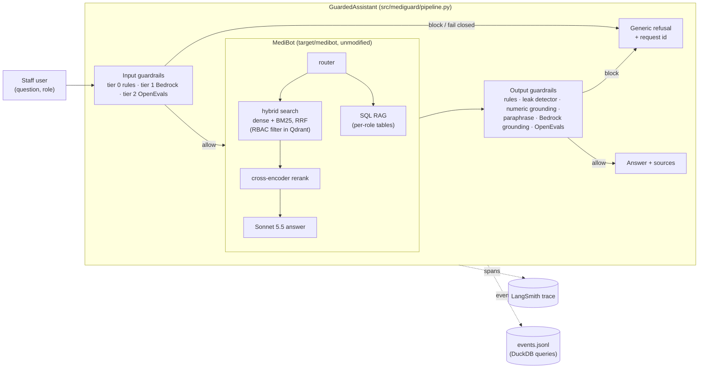

# Architecture

## Layers

| Layer | Where | What it guarantees |
|---|---|---|
| Fail-closed runner | `src/mediguard/guardrails/runner.py`, `src/mediguard/guardrails/verdict.py` | A stage allows only if every check returned a schema-valid `allow`. Exceptions, timeouts (never waited out), malformed/missing or self-contradictory verdicts, empty stages and unconfigured or crashing required checks all block. A failure in the pipeline itself (`src/mediguard/pipeline.py`) still returns the generic refusal and logs `request.failed`. |
| Input rules (tier 0) | `src/mediguard/guardrails/checks/rules_input.py`, `config/rules.yaml` | Injection phrases (also in other languages and inside base64/hex), mode switches, role play, `SYSTEM:`/`role=` tags, prompt extraction, guardrail probing, raw SQL, authority claims, invisible characters. Role claims block only if they differ from the authenticated role. |
| Bedrock Guardrails (tier 1) | `src/mediguard/guardrails/checks/bedrock.py`, `config/guardrail_policy.yaml` | Standard tier. PROMPT_ATTACK and content filters, 5 denied topics, profanity, PII (block cards/keys/Aadhaar/PAN; detect-only names/contacts), contextual grounding scores on output (detect-only, logged). |
| OpenEvals judges (tier 2) | `src/mediguard/guardrails/checks/llm_judge.py` | Haiku 4.5 classifies manipulation on input (with the role's scope) and groundedness on output. Structured output only. |
| Leak detector | `src/mediguard/guardrails/checks/leak_detector.py`, `src/mediguard/target/medibot/access_index.py` | Restricted-only markers, codes, names, verbatim 6-grams, patient/ticket identifiers and source collections are checked against what the role can read. |
| Numeric grounding | `src/mediguard/guardrails/checks/numeric_grounding.py` | Doses, rupee amounts, codes, percentages and temperatures must come from the passages or SQL rows; doses must be attributed to the right drug. |
| Refusal | `src/mediguard/guardrails/refusal.py` | One generic message with a request id. Reasons go only to traces and logs. |

## Why MediBot is wrapped, not edited

The pipeline must sit around an existing system and be reusable for others. MediBot is copied unmodified
(`target/PROVENANCE.md`, hash-checked by `tests/test_target_pristine.py`) and integrated through:

* configuration: environment variables point it at our model (Sonnet 5.5), a local Qdrant index and caches;
* runtime hooks (`src/mediguard/target/medibot/instrument.py`) that patch MediBot's functions in memory to capture what it
  retrieved, reranked and sent to the model, to open LangSmith spans and to record/replay model calls.

Another chatbot plugs in by implementing `TargetAdapter` (`src/mediguard/target/base.py`): `respond(question, role)` and
`scope(role)`.
